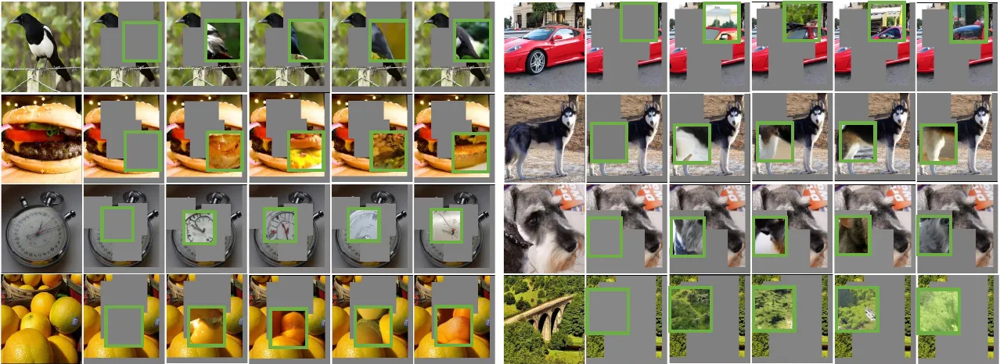

```{=html}
<div class="cover">
  <h1 class="cover-title">I-JEPA: aprender<br>a ver prediciendo<br>representaciones</h1>
  <div class="cover-aside">
    <p class="eyebrow">Resumen interactivo</p>
    <p class="name">Lucca<br>Frachelle</p>
    <p class="details">Sobre Assran et al., <em>Self-Supervised Learning from Images with a Joint-Embedding Predictive Architecture</em> (CVPR 2023), y la propuesta de LeCun (2022) que le da origen.<br><br>Redes Neuronales para Visión Artificial · Proyecto final</p>
  </div>
</div>
```

<p class="lead">Una red puede aprender mucho sobre imágenes sin ninguna etiqueta: alcanza con taparle una parte y pedirle que la complete. Lo que cambia de un método a otro es <em>qué</em> se le pide completar. I-JEPA no reconstruye los píxeles que faltan, sino que predice su representación. En este texto sigo la idea desde la propuesta de LeCun, armo el método pieza por pieza, repaso los resultados del paper y cierro con un experimento propio sobre cómo evita el colapso. Las figuras son interactivas.</p>

```{=html}
<div class="acciones">
  <a href="#sec-pregunta">1 · La pregunta</a>
  <a href="#sec-lecun">2 · La propuesta de LeCun</a>
  <a href="#sec-pixeles">3 · Píxeles o representaciones</a>
  <a href="#sec-energia">4 · Energía y colapso</a>
  <a href="#sec-ijepa">5 · I-JEPA paso a paso</a>
  <a href="#sec-mascaras">6 · El enmascarado</a>
  <a href="#sec-perdida">7 · Pérdida y EMA</a>
  <a href="#sec-resultados">8 · Resultados</a>
  <a href="#sec-critica">9 · Crítica</a>
  <a href="#sec-despues">10 · Qué vino después</a>
  <a href="#sec-experimentos">11 · Experimento propio</a>
</div>
```

## La pregunta de fondo {#sec-pregunta}

Un clasificador supervisado aprende lo justo para separar las categorías que vio, y cada imagen le aporta una sola palabra de información. LeCun lo contrasta con cómo aprendemos nosotros: un adolescente aprende a manejar en unas veinte horas de práctica porque ya trae un modelo de cómo funciona el mundo (los objetos no desaparecen, lo que se suelta se cae), y ese modelo lo armó casi todo mirando [@lecun2022path].

El aprendizaje auto-supervisado va por ese lado: se esconde o se altera parte de un dato sin etiquetar y se entrena a la red para relacionar lo que ve con lo que falta. La supervisión sale del propio dato, y después las representaciones aprendidas se reutilizan en tareas con pocas etiquetas.

::: {.caja .idea}
<span class="tag">Idea</span>
Lo que distingue a un método auto-supervisado de otro es qué se le pide predecir y dónde se mide el error. Todo lo que sigue gira alrededor de esa elección.
:::

## La propuesta de LeCun: modelos del mundo {#sec-lecun}

*A Path Towards Autonomous Machine Intelligence* [@lecun2022path] es un texto de posición, no un trabajo experimental: describe una arquitectura de seis módulos diferenciables para un agente que aprende, razona y planifica.

::: {.column-page-right}
```{=html}
<div class="ot-widget" data-widget="mundo" data-alt="Diagrama de la arquitectura de seis módulos propuesta por LeCun: configurador, percepción, modelo del mundo, costo, actor y memoria de corto plazo">
  <canvas width="1100" height="430"></canvas>
</div>
<p class="leyenda">Los seis módulos de la arquitectura de LeCun (2022), redibujados. La figura los recorre de a uno; las líneas punteadas indican que el configurador ajusta a los demás.</p>
```
:::

La pieza central, y la que LeCun considera más difícil, es el modelo del mundo: completa lo que falta del estado actual y predice estados futuros plausibles, de modo que el agente puede evaluar qué pasaría con una acción antes de ejecutarla. El problema es cómo entrenarlo. De una misma situación pueden salir muchas cosas, y la mayoría de los detalles (el dibujo exacto de las hojas, la textura del asfalto) no se pueden predecir ni importan. De ahí sale la tesis del texto:

::: {.caja .idea}
<span class="tag">La tesis</span>
Un modelo del mundo tiene que predecir en un espacio de representaciones abstractas, no en el de los datos crudos, para poder ignorar lo que es irrelevante o impredecible.
:::

La arquitectura que LeCun propone para eso es JEPA (*Joint-Embedding Predictive Architecture*), e I-JEPA la lleva a imágenes [@assran2023ijepa]. No es el primer método en imágenes que predice en el espacio de representaciones (data2vec y CAE ya lo hacían), pero sí el que se plantea explícitamente dentro de ese programa. El recorte es grande: el texto de 2022 habla de agentes, planificación y video, mientras que I-JEPA se queda con una sola pieza, aprender representaciones prediciendo en un espacio abstracto, y la prueba sobre las imágenes estáticas de ImageNet. No hay actor, ni costo, ni tiempo. Y la variable $z$, que en la propuesta original cubre lo que no se puede saber y permite varios desenlaces, en I-JEPA se reduce a indicar qué posición hay que predecir.

## Predecir píxeles o predecir representaciones {#sec-pixeles}

El camino directo para predecir lo que falta es generarlo píxel por píxel y medir el error cuadrático. Es la familia generativa, o de reconstrucción, y su representante en imágenes es MAE [@he2022mae]: tapa la mayoría de los parches y reconstruye sus píxeles.

El problema aparece cuando lo que falta no está determinado por lo que se ve. La figura arma un caso mínimo: una pelota que sale siempre del mismo punto, en una dirección imposible de anticipar, sobre un fondo de textura aleatoria. Dado el punto de partida (el contexto), hay muchos futuros igual de probables.

::: {.column-page-right}
```{=html}
<div class="ot-widget" data-widget="pixlat" data-alt="Tres paneles: a la izquierda, un futuro posible de una pelota que va cambiando; en el centro, la predicción que minimiza el error cuadrático en píxeles, una mancha borrosa; a la derecha, una tabla con la representación de ese futuro y la predicción, que coinciden">
  <canvas width="1100" height="430"></canvas>
</div>
<p class="leyenda">Izquierda: futuros sorteados, de a uno. Centro: la imagen que minimiza el error cuadrático esperado, calculada como el promedio de 240 futuros. Derecha: una representación elegida a mano que se queda sólo con lo que no depende del azar; no es un modelo entrenado. El deslizador regula cuánta incertidumbre hay en la dirección y en el fondo.</p>
```
:::

En el panel central se predicen píxeles. La predicción que minimiza el error cuadrático esperado es la media condicional $\mathbb{E}[y \mid x]$, el promedio de todos los futuros posibles. Si hay una sola dirección posible, ese promedio es nítido; a medida que crece la incertidumbre se convierte en una mancha: la pelota repartida sobre todas sus posiciones y el fondo gris liso. Es la respuesta óptima para esa pérdida, pero no se parece a ningún futuro real. Encima, para bajar el error la red tiene que gastar capacidad en la textura del fondo, que ocupa casi todos los píxeles y no dice nada de la escena. El paper de I-JEPA lo resume así: las representaciones de los métodos generativos suelen ser de menor nivel semántico, y predecir en un espacio abstracto permite eliminar detalles de píxel innecesarios [@assran2023ijepa].

En el panel derecho el objetivo ya no es la imagen futura sino una descripción de ella, $s_y$, que produce un encoder. Si ese encoder se queda con que hay una pelota, su tamaño y cuánto se alejó, y descarta la dirección exacta y la textura, todos los futuros posibles tienen la misma representación. El objetivo deja de ser aleatorio y el predictor lo puede acertar exactamente: la tabla muestra el mismo valor en las dos columnas, futuro tras futuro, mientras el panel izquierdo cambia. Con la incertidumbre en cero, la dirección también se vuelve predecible y la representación puede incluirla.

En la figura el encoder lo elegí a mano. En JEPA se aprende junto con el predictor, y por eso puede descartar lo impredecible: es el propio entrenamiento el que decide qué conservar.

::: {.caja .idea}
<span class="tag">Idea</span>
Predecir en el espacio de representaciones le permite a la red no predecir lo impredecible: el encoder puede asignarles la misma representación a todos los desenlaces compatibles.
:::

El precio es que, si el encoder puede descartar información, nada le impide descartarla toda: una representación constante también es perfectamente predecible.

## Energía y colapso {#sec-energia}

LeCun plantea estas arquitecturas como modelos basados en energía: una función $F(x, y)$ que tiene que ser baja cuando $x$ e $y$ son compatibles (dos partes de la misma imagen) y alta cuando no. Entrenar es darle forma a ese paisaje. Desde ahí, el paper distingue tres familias [@assran2023ijepa]:

::: {.column-page-right}
```{=html}
<div class="ot-widget" data-widget="tres" data-alt="Tres diagramas: arquitectura joint-embedding, arquitectura generativa y arquitectura JEPA, cada una con su punto de comparación">
  <canvas width="1100" height="400"></canvas>
</div>
<p class="leyenda">Las tres familias, redibujadas a partir de la figura 2 del paper. El círculo D marca dónde se mide la distancia. La variable z condiciona la predicción; en I-JEPA es la posición del bloque a predecir.</p>
```
:::

- **Joint-embedding.** Dos encoders producen $s_x$ y $s_y$, y se entrena para que coincidan cuando $x$ e $y$ son dos vistas de la misma imagen (SimCLR, DINO, iBOT). Logran representaciones muy semánticas, pero dependen de aumentos de vista diseñados a mano, que fijan de antemano qué tiene que ser invariante.
- **Generativa.** Un decoder reconstruye $y$ a partir de $x$ y la comparación se hace en el espacio de entrada. No necesita esos aumentos, pero paga el costo de la sección anterior.
- **JEPA.** Como la generativa, tiene un predictor que va de $x$ a $y$; como joint-embedding, compara representaciones: predice $s_y$ a partir de $s_x$.

### El riesgo de la solución trivial

Cuando se comparan representaciones, un encoder que devuelve el mismo vector para cualquier entrada lleva la pérdida al mínimo sin aprender nada. Eso es el colapso de representaciones; en términos de energía, un paisaje plano.

::: {.column-page-right}
```{=html}
<div class="ot-widget" data-widget="colapsoPasos" data-alt="Dos vistas de cuatro imágenes pasan por un encoder compartido: sin entrenar los pares están lejos; en la solución buena cada par coincide y las imágenes quedan separadas; en el colapso todas van al mismo punto con pérdida cero; en el colapso dimensional quedan sobre una recta">
  <canvas width="1100" height="430"></canvas>
</div>
<p class="leyenda">Esquema en dos dimensiones. La pérdida mide sólo la distancia dentro de cada par, así que vale lo mismo (cero, o casi) en la solución buena y en las dos formas de colapso. En el colapso dimensional las imágenes se siguen distinguiendo, pero la representación usa pocas dimensiones.</p>
```
:::

En los métodos generativos el objetivo son los píxeles, que no dependen de ninguna red, y según el paper el colapso no es un problema siempre que la capacidad informativa de $z$ sea baja comparada con la de $y$. Las arquitecturas que comparan representaciones, en cambio, necesitan un mecanismo explícito. El paper repasa los conocidos:

```{=html}
<table class="ruta">
<tr><td>Contrastivos</td><td>Separan explícitamente las representaciones de imágenes distintas (ejemplos negativos).</td></tr>
<tr><td>Regularización</td><td>Penalizan dimensiones redundantes o de poca varianza, como VICReg.</td></tr>
<tr><td>Agrupamiento</td><td>Maximizan la entropía del embedding promedio para que no todo caiga en el mismo grupo.</td></tr>
<tr><td>Asimetría</td><td>Diferencian las dos ramas: predictor en una sola, detención del gradiente (stop-gradient), o un encoder que es el promedio móvil del otro, como en BYOL.</td></tr>
</table>
```

I-JEPA usa el último: una asimetría entre el encoder de $x$ y el de $y$ [@assran2023ijepa; @grill2020byol], que detallo en la sección 7.

## I-JEPA, paso a paso {#sec-ijepa}

I-JEPA predice, a partir de un bloque de contexto, las representaciones de varios bloques objetivo de la misma imagen. Usa tres Vision Transformers (ViT): un encoder de contexto, un encoder objetivo y un predictor. Así queda un paso de entrenamiento completo:

::: {.column-page-right}
```{=html}
<div class="ot-widget" data-widget="arquitectura" data-alt="Diagrama animado de I-JEPA en siete pasos: imagen en parches, bloques de contexto y objetivo, encoder de contexto, encoder objetivo, predictor, pérdida y actualización">
  <canvas width="1100" height="430"></canvas>
</div>
<p class="leyenda">Un paso de entrenamiento, redibujado a partir de la figura 3 del paper, con la grilla reducida a 6 × 6 parches.</p>
```
:::

Abajo, cada paso tiene su propia animación con el mismo código de colores: verde para el contexto, rojo para los objetivos, azul para el predictor y gris para los parches que no son ni contexto ni objetivo.

### Paso 1: de la imagen a los tokens

Como en cualquier ViT [@dosovitskiy2021vit], la imagen se corta en parches de 16 × 16 sin superposición y cada uno pasa por la misma proyección lineal. A 224 × 224 píxeles queda una grilla de 14 × 14: 196 tokens de 768 dimensiones en un ViT-B/16, que es el modelo de las ablaciones. El ViT-H/14 principal trabaja con 16 × 16 = 256 parches.

::: {.column-page-right}
```{=html}
<div class="ot-widget" data-widget="parches" data-alt="Animación: la imagen se corta en parches, los parches se ponen en fila, cada uno se proyecta a un vector y se le suma un vector de posición">
  <canvas width="1100" height="430"></canvas>
</div>
<p class="leyenda">Paso 1, con 6 × 6 parches. Los colores del vector de posición son sólo una ayuda visual; en el modelo es un vector numérico más.</p>
```
:::

A cada token se le suma un embedding posicional 2D (senos y cosenos, fijo, no se entrena). En I-JEPA esa suma se hace antes de cualquier máscara, así que cada token lleva su posición consigo y el ViT puede trabajar sobre cualquier subconjunto de parches: los que faltan simplemente no están en la secuencia.

### Paso 2: sortear los bloques

En cada paso se sortean, para cada imagen, cuatro bloques objetivo y un bloque de contexto, al que se le sacan los parches que caen en algún objetivo para que la tarea no se reduzca a copiar. Los criterios del sorteo los discuto en la [sección 6](#sec-mascaras). Cada parche termina en uno de tres grupos:

- contexto (verde): la única entrada del encoder de contexto;
- objetivo (rojo): los parches cuya representación hay que predecir;
- ninguno (gris): no entran al encoder de contexto ni se predicen, pero sí pasan por el encoder objetivo, que procesa la imagen entera.

O sea que los objetivos no son todo lo que el contexto no ve, sino sólo los bloques sorteados.

### Paso 3: el encoder de contexto

El encoder de contexto, $f_\theta$, es un ViT común que recibe únicamente los tokens de contexto. Sus salidas, las representaciones de contexto $s_x$, son un vector por token visible, cada uno ya mezclado por atención con el resto de lo visible.

::: {.column-page-right}
```{=html}
<div class="ot-widget" data-widget="contexto" data-alt="Animación: los tokens se clasifican en contexto, objetivo y ninguno; sólo los de contexto entran al encoder de contexto">
  <canvas width="1100" height="430"></canvas>
</div>
<p class="leyenda">Paso 3: el encoder de contexto nunca ve los parches que tiene que predecir.</p>
```
:::

Como los parches objetivo no están en su entrada, la respuesta no se puede filtrar. Que procese sólo una parte de los tokens no es en sí una ventaja frente a MAE, que también codifica sólo los parches visibles; la eficiencia de I-JEPA viene de otro lado (sección 8).

### Paso 4: el encoder objetivo

El encoder objetivo, $f_{\bar\theta}$, tiene la misma arquitectura que el de contexto pero recibe la imagen completa (los 196 tokens en un ViT-B/16) y devuelve un vector por parche. En el código oficial esas salidas se normalizan con layer norm y recién después se recortan las que corresponden a cada bloque objetivo: esos son los objetivos $s_y$. Este encoder no recibe gradiente; cómo se actualiza lo cuento en el paso 7.

::: {.column-page-right}
```{=html}
<div class="ot-widget" data-widget="objetivo" data-alt="Animación: el encoder objetivo procesa los 36 tokens, se normalizan las salidas y se recortan las posiciones de los bloques objetivo; al final, el resultado de la alternativa de recortar a la entrada">
  <canvas width="1100" height="430"></canvas>
</div>
<p class="leyenda">Paso 4: el encoder objetivo ve la imagen entera y recién a la salida se recortan los bloques. La última parada compara con la alternativa de recortar a la entrada (tabla 11 del paper).</p>
```
:::

El paper mide qué pasa con ese orden. Si los bloques se recortaran a la entrada, cada objetivo se codificaría aislado del resto de la escena; recortando a la salida, la representación de cada parche objetivo incorpora información de toda la imagen. Con un ViT-H/16 entrenado 300 épocas y evaluación lineal con el 1 % de las etiquetas de ImageNet:

```{=html}
<table class="datos">
<tr><th>Dónde se recortan los objetivos</th><th>Top-1 (1 % de etiquetas)</th></tr>
<tr class="destaca"><td>A la salida del encoder objetivo</td><td>67,3</td></tr>
<tr><td>A la entrada</td><td>56,1</td></tr>
</table>
<p class="credito">Assran et al. (2023), tabla 11.</p>
```

### Paso 5: el predictor

El predictor, $g_\phi$, recibe el contexto y tiene que devolver la representación de cada parche de un bloque objetivo. Para indicarle qué región predecir:

1. Las salidas del encoder de contexto se proyectan a 384 dimensiones y se les vuelve a sumar su embedding posicional.
2. Un único token de máscara aprendido se copia una vez por cada parche del bloque objetivo.
3. A cada copia se le suma la posición de su parche. Como las copias son idénticas, la posición es lo único que las distingue y funciona como la pregunta «¿qué hay acá?». Esa posición es la $z$ de I-JEPA.
4. Contexto y tokens de máscara entran juntos a un ViT angosto, donde los tokens de máscara toman información del contexto por atención.
5. Las salidas en las posiciones de máscara se proyectan de vuelta a la dimensión del encoder y forman la predicción $\hat s_y$; las del contexto se descartan.

Cada bloque objetivo se predice en una secuencia aparte, así que los tokens de máscara de bloques distintos no se ven entre sí.

::: {.column-page-right}
```{=html}
<div class="ot-widget" data-widget="predictor" data-alt="Animación: el contexto se proyecta a 384 dimensiones, un token de máscara se copia y recibe la posición de cada parche objetivo, el predictor procesa todo junto y devuelve la predicción del bloque; se repite para el segundo bloque">
  <canvas width="1100" height="430"></canvas>
</div>
<p class="leyenda">Paso 5: el predictor se aplica una vez por bloque objetivo: cuatro veces por imagen en el paper, dos en el dibujo.</p>
```
:::

El ancho interno del predictor es 384 aunque el encoder sea mucho más ancho (1024 en un ViT-L), y tiene 12 capas para los encoders grandes (6 para el ViT-B). El paper mide las dos cosas. Ensanchar el predictor a 1024 baja el resultado con fine-tuning sobre el 1 % de las etiquetas de 70,7 a 68,4 (ViT-L/16, 600 épocas; tabla 14), así que el cuello de botella en el ancho ayuda. Con la profundidad pasa lo contrario: con evaluación lineal, 12 capas dan 66,9 y 6 capas, 64,0 (ViT-L/16, 500 épocas; tabla 12) [@assran2023ijepa].

### Pasos 6 y 7: la pérdida y la actualización

La predicción $\hat s_y$ se compara con el objetivo $s_y$ parche por parche. El paper escribe la pérdida como la distancia L2 al cuadrado, sumada sobre los parches y promediada sobre los bloques; el código oficial usa smooth L1 contra objetivos normalizados con layer norm. El gradiente actualiza el encoder de contexto y el predictor. El encoder objetivo queda afuera por la detención del gradiente (stop-gradient), implementada con `torch.no_grad()`; no hay gradient clipping. Sus pesos siguen a los del encoder de contexto por promedio móvil exponencial (EMA), con un momento $m$ que sube linealmente de 0,996 a 1 a lo largo del entrenamiento. Las fórmulas están en la [sección 7](#sec-perdida). Terminado el preentrenamiento se descartan el predictor y el encoder de contexto, y para las tareas posteriores se usa el encoder objetivo (sección 8).

## El enmascarado multi-bloque {#sec-mascaras}

Buena parte del método está en una decisión que parece de implementación: qué bloques se eligen. El paper propone una estrategia multi-bloque (*multi-block*):

- Objetivos: cuatro bloques, cada uno con un área de entre el 15 % y el 20 % de la imagen y una relación de aspecto entre 0,75 y 1,5. Se pueden superponer.
- Contexto: un solo bloque cuadrado con un área de entre el 85 % y el 100 % de la imagen, al que se le sacan los parches que caen en algún objetivo.

Los parches que no son ni contexto ni objetivo (grises en la figura) existen porque el bloque de contexto no cubre toda la imagen. Con la escala de contexto (0,85; 1) son pocos, y aumentan a medida que la escala baja.

El código de referencia tiene tres detalles que el paper no menciona. El tamaño y la forma de los bloques se sortean una vez por batch, y de una imagen a otra sólo cambia la posición. Con escala de contexto (0,85; 1), en la práctica el bloque de contexto termina siendo el cuadrado de 13 × 13 parches de arriba a la izquierda (en ViT-B/16): la última fila y la última columna nunca son ni contexto ni objetivo. Y todas las imágenes del batch usan la misma cantidad de parches de contexto, porque se recortan a la máscara más corta.

::: {.column-page-right}
```{=html}
<div class="ot-widget" data-widget="mascaras" data-alt="Imagen con grilla de 14 por 14 parches donde se sortean cuatro bloques objetivo y un bloque de contexto, con los resultados de la ablación del paper">
  <canvas width="1100" height="430"></canvas>
</div>
<p class="leyenda">Muestreo de máscaras sobre una grilla de 14 × 14. Como en el código de referencia, el tamaño de los bloques objetivo se sortea una vez y lo comparten los cuatro; la posición se sortea para cada bloque. Las configuraciones son las de las ablaciones del paper (tablas 6, 8, 9 y 10; ViT-B/16, 300 épocas, evaluación lineal con el 1 % de las etiquetas), y cada número es el resultado reportado, no una cuenta hecha acá. La imagen es un dibujo.</p>
```
:::

El paper justifica las dos condiciones así:

::: {.caja .idea}
<span class="tag">Idea</span>
Los objetivos tienen que ser lo bastante grandes como para contener algo con significado (medio pájaro, no una pluma), y el contexto tiene que ser lo bastante informativo y estar repartido en el espacio para que la predicción sea posible.
:::

Las alternativas rinden mucho peor. En rasterizado, la imagen se parte en cuadrantes y con uno se predicen los otros tres (15,5); con un solo bloque, el objetivo tiene escala 0,6 y el contexto es el complemento (20,2); en aleatorio, el objetivo es el 60 % de los parches, sueltos, como en MAE (17,6). Multi-bloque llega a 54,2.

Dentro de multi-bloque, los objetivos más chicos vuelven la tarea local, casi de textura: con escala (0,075; 0,2) el resultado cae a 19,2. Los más grandes le sacan demasiado al contexto: con (0,2; 0,3) queda en 33,6. Y usar menos objetivos también perjudica: 9,0 con uno, 22,0 con dos, 48,5 con tres.

Los números confirman la intuición del método, pero también muestran que I-JEPA es muy sensible a la máscara: subir la escala mínima de los objetivos de 0,125 a 0,15 lleva el resultado de 42,4 a 54,2. Vuelvo sobre esto en la crítica.

## La pérdida y el EMA {#sec-perdida}

Sea $M$ la cantidad de bloques objetivo (cuatro) y $B_i$ el conjunto de parches del bloque $i$. El paper escribe la pérdida como un error cuadrático en el espacio de representaciones:

::: {.formula-clave}
$$
\mathcal{L} \;=\; \frac{1}{M}\sum_{i=1}^{M}\;\sum_{j\in B_i}\bigl\lVert \hat s_{y_j} - s_{y_j}\bigr\rVert_2^2 .
$$
:::

El código oficial cambia dos cosas. Los objetivos se normalizan con layer norm (sin parámetros) antes de comparar, y la distancia es smooth L1 (con $\beta = 1$: cuadrática para errores chicos y lineal para los grandes), promediada sobre el batch, los bloques, los parches y las coordenadas en vez de sumada sobre los parches.

::: {.column-page-right}
```{=html}
<div class="ot-widget" data-widget="perdida" data-alt="Animación: para cada parche del bloque, barras de la predicción y del objetivo que se van acercando durante el entrenamiento, con la distancia de cada parche y la curva de la pérdida">
  <canvas width="1100" height="430"></canvas>
</div>
<p class="leyenda">Paso 6: la pérdida se arma por niveles. Una distancia por parche (vectores de 8 números en el dibujo; cientos en el modelo), que se promedia dentro de cada bloque, sobre los M bloques de cada imagen y sobre el batch. Los valores son ilustrativos.</p>
```
:::

La pérdida no llega a cero, ni tiene por qué: parte de lo que hay en un bloque no se puede deducir del contexto.

Los parámetros del encoder de contexto, $\theta$, y del predictor, $\phi$, se optimizan por descenso por gradiente sobre $\mathcal{L}$. Los del encoder objetivo, $\bar\theta$, no reciben gradiente por el stop-gradient: en el código, los objetivos se calculan dentro de `torch.no_grad()` y esos pesos tienen `requires_grad=False`. Arrancan como una copia de $\theta$ y después de cada paso se actualizan con un promedio móvil exponencial (EMA) de los pesos del encoder de contexto:

::: {.formula-clave}
$$
\bar\theta \;\leftarrow\; m\,\bar\theta + (1-m)\,\theta .
$$
:::

El momento $m$ empieza en 0,996 y sube linealmente hasta 1 a lo largo del entrenamiento [@assran2023ijepa]. Al principio el encoder objetivo se mueve un 0,4 % hacia el de contexto en cada paso; hacia el final ese paso tiende a cero y el encoder objetivo queda prácticamente quieto.

::: {.column-page-right}
```{=html}
<div class="ot-widget" data-widget="ema" data-alt="Simulación: trayectoria ruidosa de los pesos del encoder de contexto y trayectoria suave y retrasada del encoder objetivo, con un control para el momentum">
  <canvas width="1100" height="430"></canvas>
</div>
<p class="leyenda">Paso 7: cada punto representa todos los pesos de una red, reducidos a dos dimensiones. Los del encoder de contexto se mueven por gradiente, con ruido; los del encoder objetivo son su promedio móvil.</p>
```
:::

Con $m = 0$ el encoder objetivo es una copia del de contexto en cada paso. A medida que $m$ se acerca a 1, la trayectoria del encoder objetivo se vuelve más suave y más atrasada: con $m = 0{,}99$ promedia más o menos los últimos 100 pasos; con $m = 0{,}996$, los últimos 250. Los objetivos $s_y$ cambian despacio y el predictor no persigue un blanco que salta en cada paso.

Con el tiempo explícito se ve por qué cortar el gradiente no es un error. En el paso $t$ la pérdida es $L(\theta_t, \bar\theta_t)$ y el EMA da $\bar\theta_t = m\,\bar\theta_{t-1} + (1-m)\,\theta_{t-1}$: el objetivo de hoy depende de los $\theta$ del pasado, no de $\theta_t$. Tratarlo como fijo al derivar es exacto para ese paso. Lo que sí se ignora es el futuro: el $\theta_t$ que elijo ahora entra en $\bar\theta_{t+1}$. La actualización es miope y, como en las GAN, no hay una pérdida fija que se minimice en $\theta$ y $\bar\theta$ a la vez [@grill2020byol]. Y está bien que lo sea: si el gradiente viera esa vía, el atajo sería llevar el objetivo a una constante. Cortarla deja como única salida acercar cada predicción a un objetivo que, con pesos al azar, ya arranca separado de los demás.

### Cómo se ve el entrenamiento

Hay una sola pérdida, y la minimizan el encoder de contexto y el predictor. El encoder objetivo no la minimiza: lo arrastra el EMA. Por eso el blanco se mueve, y la curva de pérdida no se parece a la de un problema supervisado. En mis corridas (sección 11) cae enseguida, sube durante decenas de épocas mientras la representación se enriquece y recién después baja despacio. Sin EMA queda más baja todo el tiempo, con una representación mucho peor.

::: {.column-page-right}
```{=html}
<div class="ot-widget" data-widget="dinamica" data-alt="Pérdida de predicción y rango efectivo por época en corridas propias: con EMA la pérdida cae, sube mientras el rango crece y baja despacio; sin EMA la pérdida es menor pero el rango se estanca en 28">
  <canvas width="1100" height="470"></canvas>
</div>
```
:::

### Una pasada completa

Los siete pasos juntos son una iteración de entrenamiento, que se repite en cada batch con máscaras nuevas.

::: {.column-page-right}
```{=html}
<div class="ot-widget" data-widget="pasada" data-alt="Diagrama de I-JEPA que se prende etapa por etapa: tokens, máscaras, encoder de contexto, encoder objetivo, predictor, pérdida, gradiente y EMA">
  <canvas width="1100" height="430"></canvas>
</div>
```
:::

### Por qué no colapsa

::: {.column-page-right}
```{=html}
<div class="ot-widget" data-widget="noColapsa" data-alt="Cinco imágenes con su predicción y su objetivo: con gradiente por las dos ramas se juntan en un punto; con stop-gradient el objetivo queda fijo; con EMA se mueve despacio y sigue separado; sin EMA la nube se aplasta">
  <canvas width="1100" height="430"></canvas>
</div>
<p class="leyenda">Esquema. La pérdida compara cada predicción con su objetivo. Si el objetivo también recibiera gradiente, el camino más corto a pérdida cero sería llevar las dos salidas a una misma constante. El stop-gradient fija el objetivo durante cada paso, y el EMA hace que cambie despacio y herede la diversidad de un encoder que todavía distingue las imágenes. Tian et al. (2021) estudian esta dinámica en redes lineales; en el experimento de la sección 11, sin EMA el rango efectivo final cae de 102 a 28.</p>
```
:::

La combinación de predictor en una sola rama, stop-gradient hacia el objetivo y encoder objetivo por EMA es la misma de BYOL [@grill2020byol], y en la práctica funciona. La intuición es que el encoder objetivo no puede ponerse de acuerdo con el de contexto en una salida constante, porque no se optimiza: sólo lo sigue con retraso. Pero no hay una demostración de que el colapso sea imposible; lo que hay son análisis en modelos simplificados, como redes lineales [@tian2021understanding].

La simulación de abajo es uno de esos modelos: un encoder lineal, un predictor lineal y datos de juguete en tres grupos, entrenados en el navegador. No reproduce I-JEPA; sirve para ver el mecanismo.

::: {.column-page-right}
```{=html}
<div class="ot-widget" data-widget="colapso" data-alt="Simulación con una nube de embeddings y curvas de varianza y pérdida, con y sin detención del gradiente">
  <canvas width="1100" height="430"></canvas>
</div>
<p class="leyenda">Simulación ilustrativa en el navegador. Encoder lineal de 4 a 2 dimensiones, predictor lineal de 2 × 2, pérdida cuadrática entre la predicción y el embedding de una segunda vista ruidosa del mismo punto.</p>
```
:::

Sin stop-gradient hay un solo encoder y el gradiente pasa por las dos ramas: la pérdida cae enseguida a cero y la nube se contrae a un punto. El encoder aprendió a devolver siempre lo mismo; la pérdida es mínima y la representación no sirve para nada. Mirando sólo la curva de pérdida el colapso no se nota; lo delata la varianza. Con stop-gradient y EMA la pérdida se estabiliza por encima de cero (las dos vistas tienen ruido distinto) y los tres grupos siguen separados. En este modelo de juguete incluso $m = 0$, un encoder objetivo que es copia del de contexto pero sin gradiente, alcanza para no colapsar; en modelos grandes el promedio lento importa además para que los objetivos sean estables.

::: {.caja .prueba}
<span class="tag">Cuidado</span>
En un método de este tipo, que la pérdida baje no quiere decir que el entrenamiento vaya bien. Hay que seguir alguna medida de la diversidad de las representaciones.
:::

## Qué muestran los resultados {#sec-resultados}

El protocolo principal es la evaluación lineal. Después del preentrenamiento sin etiquetas en ImageNet-1k se descartan el encoder de contexto y el predictor, se congela el encoder objetivo, se promedian (average pooling) las salidas de los parches de cada imagen y encima se entrena sólo un clasificador lineal. Así salen la tabla 1 y las de transferencia (el paper reporta lo mejor entre la última capa y la concatenación de las cuatro últimas), y también las ablaciones con el 1 % de las etiquetas. Los resultados con el 1 % de la tabla 2, en cambio, son con fine-tuning del encoder (protocolo de MAE, 50 épocas).

::: {.column-page-right}
```{=html}
<div class="ot-widget" data-widget="evaluacion" data-alt="Animación: se descartan el encoder de contexto y el predictor; el encoder objetivo congelado procesa una imagen nueva, sus vectores se promedian y un clasificador lineal da las probabilidades de cada clase">
  <canvas width="1100" height="430"></canvas>
</div>
<p class="leyenda">Evaluación lineal. Las clases y probabilidades son ilustrativas.</p>
```
:::

::: {.column-page-right}
```{=html}
<div class="ot-widget" data-widget="resultados" data-alt="Gráfico de puntos con los resultados reportados de I-JEPA y otros métodos en evaluación lineal, con 1 por ciento de etiquetas y en tareas de bajo nivel">
  <canvas width="1100" height="430"></canvas>
</div>
<p class="leyenda">Números de las tablas 1, 2 y 4 de Assran et al. (2023). En la tabla 2 (1 % de etiquetas), I-JEPA usa fine-tuning, y cada uno de los demás métodos, lo mejor entre fine-tuning y evaluación lineal. En rojo, I-JEPA; en azul, otros métodos sin aumentos de vista diseñados a mano; en gris, los que sí los usan. Las arquitecturas y cantidades de épocas difieren, como en el paper.</p>
```
:::

En evaluación lineal, entre los métodos sin aumentos de vista diseñados a mano (I-JEPA sí aplica un recorte aleatorio a su única vista), I-JEPA con ViT-H/14 llega a 79,3 en 300 épocas, por encima de MAE (77,2) y data2vec (77,3), que entrenan 1600. Un ViT-H/16 preentrenado a 448 px llega a 81,1, a la par de iBOT (81,0), que sí usa aumentos.

Con el 1 % de las etiquetas (12 o 13 imágenes por clase) y fine-tuning, I-JEPA con ViT-H/14 empata con data2vec con ViT-L/16 (73,3) y supera a MAE (71,5). El ViT-H/16 a 448 px llega a 77,3, por encima de MSN (75,7), el mejor de los métodos con aumentos en esa tabla.

En transferencia y tareas de bajo nivel la comparación es más pareja. Los métodos basados en invariancia tienden a perder información local, porque se entrenan justamente para ignorar ese tipo de diferencias. En predicción de profundidad sobre Clevr, I-JEPA (72,4) iguala a MAE y supera de lejos a DINO (53,4) e iBOT (62,8). En conteo de objetos queda por debajo de MAE (86,7 contra 90,5), y en transferencia a iNaturalist 2018, por debajo de DINO e iBOT (47,6 contra 55,9 y 57,3).

### El costo de entrenar

El argumento más fuerte del paper es la eficiencia. Un ViT-H/14 se preentrena en ImageNet con 16 A100 en menos de 72 horas (menos de 1200 horas de GPU): más de 2,5 veces más rápido que un ViT-S/16, mucho más chico, entrenado con iBOT, y más de 10 veces más eficiente que un ViT-H/14 con MAE.

El ahorro tiene orígenes distintos según con qué se compare. Frente a métodos con aumentos como iBOT, I-JEPA procesa una sola vista de cada imagen en lugar de varias. Frente a MAE no hay ahorro por iteración: calcular los objetivos con el encoder objetivo sobre la imagen entera hace que cada iteración sea alrededor de un 7 % más lenta, pero I-JEPA converge en unas cinco veces menos iteraciones.

### Qué aprende el predictor

Para ver qué contiene la salida del predictor, los autores congelan el modelo y entrenan aparte un decoder generativo (RCDM) que lleva a píxeles el promedio de esas salidas. Es sólo una herramienta de visualización; no participa del entrenamiento.

::: {.column-page-right}
```{=html}
<figure class="original">
  
</figure>
<p class="credito">Figura 6 de Assran et al. (2023), reproducida del original. Primera columna: imagen original. Segunda: el contexto que ve el encoder. Resto: muestras de un modelo generativo que decodifica la salida del predictor para la región del recuadro verde.</p>
```
:::

Lo que se repite entre muestras es lo que la predicción contiene; lo que varía, lo que no. El predictor acierta la parte del objeto y su pose (el lomo del pájaro, el techo del auto) y deja libres los detalles finos y el fondo. Según los autores, así capta la incertidumbre posicional del bloque objetivo. Lo que no tiene es una variable latente que le permita representar varios desenlaces: produce una sola predicción por bloque.

## Crítica y limitaciones {#sec-critica}

Separo lo que sale de los números del propio paper de lo que es lectura mía. Primero, lo que muestran los datos:

- *Sensibilidad a la máscara.* Las ablaciones de la sección 6 muestran saltos de decenas de puntos por cambios chicos en la escala o en la cantidad de bloques: el método depende de una configuración bien afinada.
- *No gana en todo.* En iNaturalist queda detrás de DINO e iBOT; en conteo, detrás de MAE; con fine-tuning completo en ImageNet saca 87,1 contra 87,8 de MAE, aunque con 5,3 veces menos épocas.
- *Comparaciones no controladas.* Las tablas enfrentan arquitecturas, resoluciones y cantidades de épocas distintas. Es lo habitual en el área, pero así no se aísla el efecto del método.
- *Sin garantía contra el colapso.* Se evita con un diseño que funciona en la práctica; el paper remite a análisis en escenarios simplificados.

Y lo que es lectura mía:

- *El sesgo inductivo cambia de lugar.* El paper presenta como ventaja no depender de aumentos de vista diseñados a mano, pero la estrategia de enmascarado también es un diseño a mano, con hiperparámetros tan influyentes como los de un aumento. Es un supuesto más débil y más general (no dice qué tiene que ser invariante), pero sigue siendo un supuesto.
- *Lejos del programa original.* I-JEPA trabaja con imágenes estáticas, sin tiempo, acciones ni planificación: predice otra región de la misma imagen, no una consecuencia. Llamarlo modelo del mundo es generoso; los propios autores, cuando lo comunican, hablan de un modelo del mundo primitivo y restringido.
- *Una sola predicción por posición.* El predictor capta incertidumbre posicional (figura 6), pero devuelve una única predicción por parche objetivo. Su $z$ es la posición; falta la variable latente que, en la propuesta de LeCun, permitía representar varios desenlaces posibles.

## Qué vino después {#sec-despues}

La línea siguió en dos direcciones: hacia el video y las acciones, y hacia una justificación de cómo evitar el colapso.

```{=html}
<table class="ruta">
<tr><td>2024 · IWM</td><td><em>Image World Models</em> generaliza la tarea de I-JEPA: además de regiones enmascaradas, el predictor aprende el efecto de transformaciones fotométricas globales, y se estudia cuándo las representaciones resultan invariantes o equivariantes.</td></tr>
<tr><td>2024 · V-JEPA</td><td>Lleva la predicción de representaciones a video.</td></tr>
<tr><td>2025 · V-JEPA 2</td><td>Escala el preentrenamiento en video y agrega un modelo del mundo condicionado por acciones, usado para planificar tareas de manipulación con robots.</td></tr>
<tr><td>2025 · LeJEPA</td><td>Balestriero y LeCun proponen SIGReg, que lleva los embeddings hacia una gaussiana isótropa y, según los autores, permite prescindir de la detención del gradiente y del esquema maestro-alumno.</td></tr>
<tr><td>2026 · SPHERE-JEPA</td><td>Nicollier y otros cuestionan la geometría de LeJEPA y proponen SUSReg, que lleva los embeddings hacia la uniforme sobre la esfera.</td></tr>
</table>
<p class="credito">Resúmenes a partir de los resúmenes publicados de cada trabajo [@garrido2024iwm; @bardes2024vjepa; @assran2025vjepa2; @balestriero2025lejepa; @nicollier2026spherejepa].</p>
```

V-JEPA 2 incorpora tiempo y acciones, que era lo que faltaba para acercarse al modelo del mundo de 2022. LeJEPA y SPHERE-JEPA buscan cambiar las heurísticas contra el colapso por un criterio con fundamento, pero ninguno de los dos se probó con las máscaras de I-JEPA. Eso es lo que hago en la sección siguiente.

## Un experimento propio: ¿se puede reemplazar el EMA? {#sec-experimentos}

I-JEPA evita el colapso con una combinación de recursos (predictor en una sola rama, stop-gradient, encoder objetivo por EMA) que funciona sin una justificación teórica (sección 7). LeJEPA [@balestriero2025lejepa], de Balestriero y LeCun (2025), y SPHERE-JEPA [@nicollier2026spherejepa], de Nicollier y otros, entre ellos Pablo Musé (2026), proponen otra salida: en vez de una asimetría entre ramas, un término de la pérdida que fija la forma de la distribución de los embeddings. Si ese término alcanza para evitar el colapso, el EMA estaría de más.

Que eso valga para I-JEPA no es obvio, por dos motivos. Los dos trabajos se evaluaron con vistas aumentadas, dentro del marco de invariancia de la sección 4, y ninguno con las máscaras de I-JEPA. Y aun en ese marco el EMA no sobra: en la tabla 3 de SPHERE-JEPA (ViT-B/14, ImageNet-1K, 100 épocas), sacarlo le cuesta entre 8 y 12 puntos a cada método, con el regularizador puesto. Los autores lo atribuyen, sin aislarlo, a que el EMA da objetivos que cambian despacio, algo que un término sobre la distribución del batch no controla.

### Dos regularizadores, por arriba

Los dos regularizadores miran el batch entero, no cada imagen por separado. Toman los embeddings de las imágenes del batch, los tratan como una muestra de una distribución y penalizan que esa distribución se aleje de una forma fijada de antemano. Si esa forma ocupa todas las dimensiones, el batch no puede concentrarse en un punto ni en un subespacio chico, que es justamente el colapso.

- SIGReg (LeJEPA) usa como forma una gaussiana isótropa: una nube redonda, igual de ancha en todas las direcciones.
- SUSReg (SPHERE-JEPA) primero normaliza cada embedding, así que todos quedan sobre una esfera, y usa como forma la distribución uniforme sobre esa esfera. Los autores la justifican con un argumento de peor caso: la uniforme sobre la variedad es óptima para k-NN, y la uniforme sobre la esfera, para regresión ridge con kernel.

La figura de abajo recorre el mecanismo en cuatro pasos, en dos dimensiones para poder dibujarlo.

1. El batch: cada punto es el embedding de una imagen. Los tres paneles arrancan del mismo batch, alargado y casi apoyado sobre una recta.
2. Qué hace cada término: sin regularizador, nada impide que el batch termine sobre una recta y use una sola de las dos dimensiones (colapso dimensional). Con SIGReg toma forma de gaussiana redonda; con SUSReg queda sobre el círculo, repartido parejo.
3. Cómo se mide la forma: comparar una nube de 256 dimensiones con una distribución de referencia no es práctico. Lo que sí se puede comparar es una proyección: se elige una dirección al azar, se proyecta cada punto sobre ella (su «sombra» sobre la recta punteada) y queda una distribución en una dimensión. Esa sombra se compara con la que tendría la forma buscada: una campana para la gaussiana y, para el círculo en dos dimensiones, una distribución que se acumula en los bordes.
4. Muchas direcciones: una sola sombra no alcanza, porque una nube aplastada puede tener la sombra correcta en alguna dirección. Por el teorema de Cramér–Wold, una distribución queda determinada por todas sus proyecciones unidimensionales, así que se repite con muchas direcciones: 1024 por paso, sorteadas de nuevo cada vez. La penalización es el promedio sobre todas.

En la figura las sombras se dibujan como histogramas para que se vean. En el código, cada comparación la hace el estadístico de Epps–Pulley, que mide la distancia entre la función característica empírica de la proyección y la de la referencia en una grilla de frecuencias. En el experimento usé las implementaciones oficiales de SPHERE-JEPA, sin modificar.

::: {.column-page-right}
```{=html}
<div class="ot-widget" data-widget="regs" data-alt="Cuatro pasos: el mismo batch de puntos en tres paneles; sin regularizador el batch se aplasta sobre una recta, con SIGReg se vuelve una gaussiana redonda y con SUSReg queda repartido sobre un círculo; después se proyecta el batch sobre una dirección al azar y su histograma se compara con la forma buscada; por último se repite con varias direcciones">
  <canvas width="1100" height="430"></canvas>
</div>
<p class="leyenda">Esquema en dos dimensiones; en el experimento los embeddings tienen 256. En 256 dimensiones, la sombra de una esfera uniforme ya no se acumula en los bordes y se parece mucho a una campana.</p>
```
:::

### Cómo entran en I-JEPA

En cada paso, los tokens visibles que produce el encoder de contexto se promedian en un vector de 192 dimensiones por imagen. Ese vector pasa por una cabeza de proyección: un MLP 192 → 2048 → 2048 → 256 con BatchNorm y GELU, el mismo de SPHERE-JEPA, de unos 5 M de parámetros (del orden del ViT-Tiny entero). El regularizador se calcula sobre las 256 salidas de la cabeza para el batch de 256 imágenes, y la pérdida total es

$$L = L_\text{pred} + \lambda\, L_\text{reg},$$

donde $L_\text{pred}$ es la pérdida de I-JEPA sin cambios (smooth L1 contra los objetivos normalizados con layer norm). El gradiente de $L_\text{reg}$ llega al encoder de contexto a través de la cabeza, que sólo existe en las celdas con regularizador y no interviene en la evaluación.

«Sin EMA» quiere decir que el encoder objetivo es el propio encoder de contexto, con los mismos pesos, aplicado a la imagen completa y con stop-gradient; equivale a $m = 0$. En esas celdas, el encoder que se evalúa es el mismo que se entrena.

### Diseño

Crucé dos factores: si el encoder objetivo usa EMA o no, y qué regularizador se suma a la pérdida.

```{=html}
<table class="datos">
<tr><th></th><th>con EMA</th><th>sin EMA</th></tr>
<tr><td>sin regularizador</td><td class="destaca"><strong>C1</strong> · I-JEPA tal cual</td><td><strong>C2</strong> · control: debería colapsar</td></tr>
<tr><td>SIGReg (gaussiana)</td><td><strong>C3</strong></td><td><strong>C4</strong></td></tr>
<tr><td>SUSReg (esfera)</td><td><strong>C5</strong></td><td><strong>C6</strong></td></tr>
</table>
```

Cada pregunta es una comparación entre celdas:

- P1. ¿El regularizador puede reemplazar al EMA? C4 y C6 contra C1.
- P2. ¿Importa la geometría? C6 contra C4, y C5 contra C3.
- P3. ¿EMA y regularizador se suman? C3 y C5 contra C1.

C2 es el control: sin EMA ni regularizador, I-JEPA debería colapsar, y C4 y C6 muestran si el regularizador lo evita.

**Configuración.** ViT-Tiny/16 (192 dimensiones, 12 capas, predictor de 6 capas) sobre ImageNet-100 a 224 px, 100 épocas, batch de 256 y 3 semillas por celda (C2: 1); es la escala de la tabla 7 de SPHERE-JEPA. Las máscaras, el optimizador (AdamW con los cronogramas oficiales de I-JEPA) y el cronograma del EMA (de 0,996 a 1) son los mismos en todas las celdas. La grilla son 16 corridas y unas 40 h de GPU en una RTX 5090 Laptop (24 GB); los barridos llevaron otras ~7 h y la calibración, ~32 h.

**Barridos.** Los hiperparámetros salieron de corridas de 30 épocas con semilla 0, evaluadas con k-NN sobre un split interno de 12 669 imágenes apartadas del train, nunca sobre el val oficial. La tasa de aprendizaje la barrí en C1 ($2{,}5 \times 10^{-4}$, $5 \times 10^{-4}$, $10^{-3}$) y ganó $2{,}5 \times 10^{-4}$. A $\lambda$ lo barrí por separado en C4 y C6 (0,01, 0,05 y 0,2) y en los dos casos ganó 0,05, el valor por defecto de LeJEPA; con 0,2 el k-NN cae de ~18 a 10,7 (C4) y 7,4 (C6). Ese $\lambda$ lo reusé en las celdas con EMA.

**Evaluación.** La del código de SPHERE-JEPA: encoder objetivo congelado, promedio de tokens y encima un clasificador lineal (SGD, 90 épocas) o k-NN (coseno, $k = 20$, $T = 0{,}07$), con precisión top-1 sobre el val oficial. Cada celda se reporta como media ± desvío estándar muestral entre semillas. Antes de correr fijé que una diferencia cuenta como distinguible si supera dos desvíos de la celda más variable o si un test t pareado por semilla da $p < 0{,}05$. Contra C2, que tiene una sola semilla, no hay test.

**Calibración.** Antes de la grilla corrí el código oficial de SPHERE-JEPA, sin modificar, sobre los mismos datos: 72,8 en evaluación lineal y 70,6 en k-NN, contra 71,9 y 69,0 publicados, dentro del margen de ±2 puntos que había fijado de antemano. Esto valida los datos y la evaluación, no mi implementación del entrenamiento de I-JEPA.

### Resultados

::: {.column-page-right}
```{=html}
<div class="ot-widget" data-widget="grilla" data-alt="A la izquierda, la tabla 2 por 3 con la precisión de cada celda; a la derecha, barras con media y desvío de cada celda y flechas con la diferencia de cada comparación; botones para elegir la pregunta y la métrica">
  <canvas width="1100" height="430"></canvas>
</div>
<p class="leyenda">Precisión top-1 en el val oficial de ImageNet-100. Barra: media de las semillas; línea: ±1 desvío estándar.</p>
```
:::

```{=html}
<table class="datos">
<tr><th>Celda</th><th>EMA</th><th>Regularizador</th><th>Lineal</th><th>k-NN</th></tr>
<tr><td class="destaca"><strong>C1</strong></td><td>sí</td><td>no</td><td class="destaca"><strong>43,40 ± 0,22</strong></td><td class="destaca"><strong>38,05 ± 0,87</strong></td></tr>
<tr><td><strong>C2</strong></td><td>no</td><td>no</td><td>19,44</td><td>14,70</td></tr>
<tr><td><strong>C3</strong></td><td>sí</td><td>SIGReg</td><td>28,37 ± 0,70</td><td>23,18 ± 1,00</td></tr>
<tr><td><strong>C4</strong></td><td>no</td><td>SIGReg</td><td>25,03 ± 0,33</td><td>21,81 ± 0,24</td></tr>
<tr><td><strong>C5</strong></td><td>sí</td><td>SUSReg</td><td>26,45 ± 1,48</td><td>21,26 ± 1,00</td></tr>
<tr><td><strong>C6</strong></td><td>no</td><td>SUSReg</td><td>21,57 ± 0,66</td><td>19,28 ± 0,58</td></tr>
</table>
```

I-JEPA sin modificar (C1) le gana a todas las demás celdas; las cuatro con regularizador quedan entre 19 y 28 % de precisión y C2 queda última. Los desvíos entre semillas van de 0,2 a 1,5 puntos, así que las diferencias grandes no son ruido.

**P1: el regularizador no reemplaza al EMA.** Sin EMA, los dos regularizadores mejoran al control: C4 lo supera por 5,6 puntos en lineal y 7,1 en k-NN, y C6 por 2,1 y 4,6. Pero quedan entre 16 y 22 puntos por debajo de C1, más de 10 desvíos, en las dos métricas.

**P2: la esfera no gana.** Sin EMA, la gaussiana le gana a la esfera por 3,5 puntos en lineal y 2,5 en k-NN, una diferencia distinguible ($p = 0{,}004$ y $0{,}018$). Con EMA, C3 supera a C5 por 1,9 puntos en las dos métricas, sin llegar al umbral ($p = 0{,}076$ y $0{,}054$). En ningún caso la esfera supera a la gaussiana, algo que no sorprende tanto: la propia tabla 4 de SPHERE-JEPA (ResNet-18, ImageNet-100) ya pone a LeJEPA adelante.

**P3: juntos, restan.** Sumarle el regularizador a I-JEPA con EMA le saca 15 puntos (SIGReg) o 17 (SUSReg), en las dos métricas y de forma distinguible.

Leída por columnas, la grilla separa los dos factores. Con regularizador, agregar el EMA suma poco: 3,3 puntos en lineal y 1,4 en k-NN con SIGReg (C3 contra C4), 4,9 y 2,0 con SUSReg (C5 contra C6), bastante menos que los 8 a 12 de la tabla 3 de SPHERE-JEPA. Sin regularizador, el EMA vale unos 24 puntos (C1 contra C2). La distancia de P1 entre C4 y C1, 18,4 puntos en lineal, se descompone entonces en 15,0 que cuesta agregar el regularizador con EMA y 3,3 que cuesta sacar el EMA con regularizador.

### Qué pasó con el colapso

Durante el entrenamiento medí dos indicadores cada 5 épocas, sobre 10 000 imágenes fijas del train. Los calculé sobre la representación que se evalúa (el promedio de tokens del encoder objetivo, de 192 dimensiones), no sobre la salida de la cabeza en la que actúa el regularizador. El rango efectivo [@roy2007erank] es la exponencial de la entropía de los valores singulares normalizados de la matriz de embeddings: vale 1 si todos los vectores son iguales y se acerca a 192 si ocupan todas las dimensiones por igual. La uniformidad [@wang2020uniformity] es $\log \mathbb{E}\, e^{-2\lVert z_i - z_j \rVert^2}$ sobre embeddings normalizados; cuanto más negativa, más repartidos están sobre la esfera.

::: {.column-page-right}
```{=html}
<div class="ot-widget" data-widget="rango" data-alt="Curvas del rango efectivo por época para las seis celdas: C1 sube hasta cerca de 100, las celdas con regularizador arrancan altas y se estancan entre 57 y 69, y C2 queda cerca de 28">
  <canvas width="1100" height="430"></canvas>
</div>
<p class="leyenda">Rango efectivo del promedio de tokens del encoder objetivo, cada 5 épocas, sobre 10 000 imágenes de entrenamiento; media de las semillas.</p>
```
:::

- C2 colapsó sólo en parte. En la época 5 quedó cerca del umbral del criterio de colapso que había fijado, con rango efectivo 9; subió hasta ~28 hacia la época 20 y ahí se quedó. Terminó en un colapso dimensional: rango ~28 contra ~102 de C1, la peor uniformidad de la grilla y la menor pérdida de predicción (0,14 contra 0,22 de C1 en la semilla 0), porque con pocas dimensiones el objetivo es más fácil de predecir. Una corrida de prueba de 5 épocas con tasa de aprendizaje $5 \times 10^{-4}$ sí colapsó (rango ~4), así que el modo sin EMA hace lo que se espera; la recuperación parcial la atribuyo al warmup lento. Como control, C2 quedó más débil de lo que había previsto.
- Los regularizadores actúan desde el principio. En la época 5 las celdas con regularizador tienen rango entre 36 y 69, contra 23 de C1 y 9 de C2. En ese momento $\lambda L_\text{reg}$ pesa más que la predicción (con SIGReg, ~0,31 contra ~0,21 en la primera época); al final baja a ~0,035.
- Después se estancan. Terminan entre 57 y 69: las de SIGReg crecen despacio hasta estabilizarse y las de SUSReg bajan desde su máximo, que alcanzan entre las épocas 5 y 20. C1, en cambio, sube hasta ~104 hacia la época 75 y termina en ~102. Las celdas con SIGReg tienen la distribución más uniforme de la grilla (−2,3 contra −1,6 de C1) y aun así rinden 15 a 18 puntos menos que C1.

La pérdida de predicción termina en el mismo nivel en C1 y en las celdas con regularizador (0,21 a 0,23): el regularizador no le impide aprender a predecir, sino que cambia qué representación aprende.

### Interpretación

Los regularizadores evitan el colapso dimensional que sufre I-JEPA sin EMA, pero con eso no alcanza, y una representación más uniforme no resulta más útil. Una lectura posible, que SPHERE-JEPA también sugiere, es que el EMA cumple dos funciones: evitar el colapso, que el regularizador también logra, y darle a la predicción un objetivo que cambia despacio, que el regularizador no aporta. La grilla la apoya sólo en parte: el EMA sigue sumando con regularizador, pero poco, y lo que más pesa en la distancia a C1 es el propio regularizador. Mi interpretación es que, con este $\lambda$, empujar la cabeza hacia una distribución fija lleva al encoder a una solución peor que la que encuentra I-JEPA sola, aunque la predicción se siga aprendiendo igual de bien. Para P2 tengo una hipótesis que no probé: SUSReg restringe sólo la dirección de los embeddings, y SPHERE-JEPA lo combina con una pérdida L2 al cuadrado entre embeddings normalizados a la esfera y su prototipo, casi una similitud coseno; la de I-JEPA, en cambio, es una regresión sobre objetivos normalizados con layer norm, con la que la geometría esférica puede encajar peor.

::: {.caja .prueba}
<span class="tag">Límites del experimento</span>
Escala chica (ViT-Tiny, ImageNet-100, 100 épocas), lejos del régimen en el que I-JEPA rinde: a esta escala queda muy por debajo de LeJEPA y SPHERE-JEPA con vistas aumentadas, así que los resultados se comparan entre celdas y no contra los papers. $\lambda$ se eligió sin EMA y se reusó con EMA, por lo que el experimento no distingue «el regularizador estorba» de «este $\lambda$ es demasiado grande cuando ya hay EMA»; eso afecta sobre todo a P3 y a la descomposición anterior. C2 tiene una sola semilla y colapsó sólo en parte, de modo que «evita el colapso» se apoya en un control más débil de lo previsto. El regularizador se aplicó en un solo lugar (la cabeza sobre el promedio de tokens de contexto) y con la pérdida de I-JEPA. Lo que seguiría es barrer $\lambda$ con EMA y probar SUSReg con una pérdida esférica.
:::

## Resumen en seis ideas {#sec-resumen}

1. Aprender prediciendo funciona sin etiquetas, pero el espacio donde se mide el error decide qué se aprende: en píxeles, el modelo gasta capacidad en detalles que no se pueden anticipar.
2. JEPA lleva la predicción al espacio de representaciones, donde el propio modelo puede descartar lo impredecible.
3. En I-JEPA un encoder ve una parte de la imagen, otro la ve entera, y un predictor angosto, condicionado por la posición, conecta los dos.
4. Que la representación sea semántica depende sobre todo de la máscara: bloques objetivo grandes y un contexto informativo y repartido.
5. El colapso se evita con asimetría (stop-gradient y EMA), una solución empírica que motivó la búsqueda de regularizadores con fundamento.
6. En mi experimento, SIGReg y SUSReg evitaron el colapso dimensional de I-JEPA sin EMA, pero no recuperaron su rendimiento, y sumados al EMA lo empeoraron (al menos con el $\lambda$ elegido); la geometría esférica no superó a la gaussiana.

## Referencias {.unnumbered}

::: {#refs}
:::

<p class="pie"><strong>Declaración de uso de IA.</strong> Usé un asistente de IA (Claude, de Anthropic) para programar las animaciones, autocompletar algunas fórmulas y otras tareas de apoyo. Los experimentos y su código también los hizo en su mayoría el asistente. Todo tuvo intervención humana: yo guié el proceso y revisé y corregí cada resultado.</p>

<p class="pie">Proyecto final de Redes Neuronales para Visión Artificial. Los diagramas y las animaciones son propios, salvo la figura 6 del paper, reproducida con crédito. Los números del paper provienen de Assran et al. (2023); los de la sección 11 son de corridas propias.</p>
