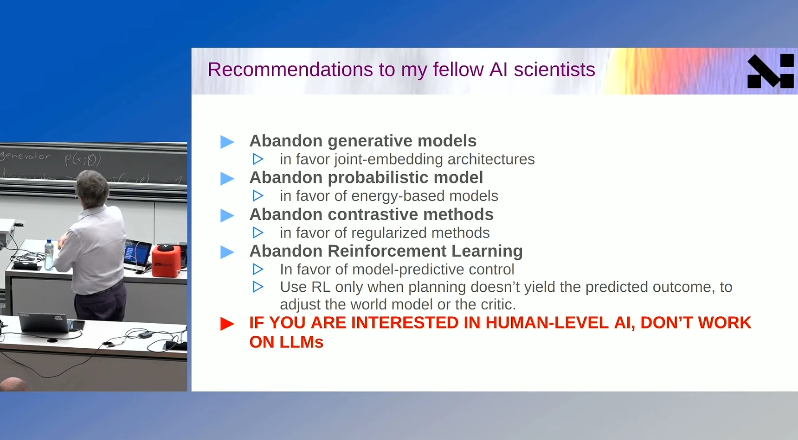
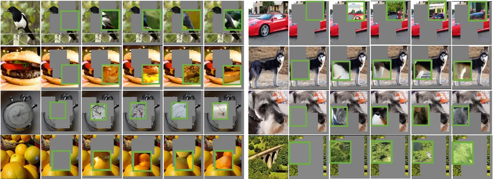

## {.cover}

<div class="cover-layout">
<div><h2>I-JEPA<br><span class="subtitulo">Por qué Yann LeCun está tan enojado con los LLMs</span></h2></div>
<div class="cover-aside">
<p class="eyebrow">Proyecto final</p>
<p class="name">Lucca<br>Frachelle</p>
<p class="details"> DLvis<br> UDELAR - FING · 26/11/2026</p>
</div>
</div>

## Intro
{style="max-height:480px; width:auto; display:block; margin:0 auto; border-radius:8px;" fig-alt="Yann LeCun en ETH Zürich frente a su slide «Recommendations to my fellow AI scientists»: abandonar los modelos generativos, los probabilísticos, los métodos contrastivos y el aprendizaje por refuerzo; y en rojo: «If you are interested in human-level AI, don't work on LLMs»"}

<p class="credito">Yann LeCun, «World Models: Enabling the next AI revolution», ciclo Frontiers of Embodied AI, ETH Zürich, 2026.</p>

## Intro

::: {.grande}
Un adolescente aprende a manejar en unas 20 horas (a mí me llevó bastante más).


Un sistema automático necesita enormes cantidades de datos etiquetados o de ensayos.
:::

::: {.caja .idea}
<span class="tag">La hipótesis de LeCun</span>
La diferencia es el conocimiento previo de cómo funciona el mundo, y casi todo se adquiere observando, sin etiquetas.
:::

## La idea {.section-break background-color="#0f3460"}

<p class="sub">LeCun (2022), *A Path Towards Autonomous Machine Intelligence*</p>


## Una arquitectura para un agente que predice

{style="max-height:460px; width:auto; display:block; margin:0 auto;" fig-alt="Los seis módulos de la arquitectura de LeCun dibujados sobre un cerebro: configurador, percepción, modelo del mundo, costo (intrínseco y crítico), actor y memoria de corto plazo; el actor actúa sobre el mundo y la percepción recibe lo que el mundo devuelve"}

<p class="leyenda">Los módulos de la arquitectura de LeCun (2022). Figura de Dawid y LeCun (2023), notas de Les Houches. </p>

## El modelo del mundo

::: {.columns}
::: {.column width="55%"}
- Trabaja sobre un estado abstracto $s_t$, no sobre la observación cruda.
- Predice el próximo estado dada una acción:
$$
s_{t+1} = \text{Pred}(s_t,\ a_t,\ z_t)
$$
- $z_t$ es una variable latente: cubre lo que no se puede saber y permite varios desenlaces.
- Planificar es buscar la secuencia de acciones que minimiza un costo sobre lo predicho.
:::
::: {.column width="45%"}
::: {.caja .idea}
<span class="tag">El problema de aprendizaje</span>
Antes de planificar hay que aprender, sin etiquetas, un encoder que produzca $s$ y un predictor que funcione en ese espacio.
:::

::: {.caja .prueba}
<span class="tag">Dónde entra I-JEPA</span>
Resuelve sólo esa pieza, en imágenes estáticas: sin tiempo ni acciones, y con una $z$ que sólo indica qué posición predecir, no una latente que admita varios desenlaces.
:::
:::
:::

## Latentes y yo, mejores amigos

::: {.columns}
::: {.column width="50%"}
**predecir el dato**

- Predecir los píxeles que faltan.
- Es lo que hace un MAE.
- El objetivo es fijo: no colapsa mientras $z$ lleve poca información. Pero lo aprendido suele ser de menor nivel semántico.
:::
::: {.column width="50%"}
**predecir una representación**

- Codificar lo que falta con un encoder.
- Predecir esa representación.
- El encoder puede descartar el detalle de píxel innecesario.
:::
:::

::: {.caja .idea}
<span class="tag">La tesis de LeCun</span>
Un modelo del mundo tiene que predecir en un espacio de representaciones, porque buena parte de los detalles del mundo son impredecibles e irrelevantes.
:::

## El problema de predecir píxeles

```{=html}
<div class="ot-widget" data-widget="pixlat" data-alt="Un futuro posible, la predicción promedio en píxeles y la predicción en representación">
  <canvas width="1100" height="430"></canvas>
</div>
```

## Tres maneras de armar el problema

```{=html}
<div class="ot-widget" data-widget="tres" data-alt="Arquitecturas joint-embedding, generativa y JEPA">
  <canvas width="1100" height="400"></canvas>
</div>
<p class="leyenda">Redibujado de la figura 2 de Assran et al. (2023). D marca dónde se mide la distancia.</p>
```

## El colapso

```{=html}
<div class="ot-widget" data-widget="colapsoPasos" data-alt="Dos vistas de cuatro imágenes pasan por un encoder compartido: sin entrenar los pares están lejos; en la solución buena cada par coincide y las imágenes quedan separadas; en el colapso todas van al mismo punto con pérdida cero; en el colapso dimensional quedan sobre una recta">
  <canvas width="1100" height="430"></canvas>
</div>
```

## Evitar el colapso: contrastivo o regularizado

La energía $F(x, y)$ (en una JEPA, la distancia $D(\hat s_y, s_y)$) tiene que quedar baja sobre los datos y alta en el resto. LeCun distingue dos maneras; I-JEPA usa una tercera.

{style="max-height:500px; width:auto; display:block; margin:4px auto 0;" fig-alt="Tres paneles: (a) paisaje de energía con la región de baja energía y las muestras de entrenamiento; (b) método contrastivo, con muestras contrastivas fuera de la región; (c) método regularizado, con flechas que comprimen la región de baja energía"}

<p class="leyenda">Dawid y LeCun (2023), adaptada de LeCun (2022).</p>


## I-JEPA {.section-break background-color="#0f3460"}

<p class="sub">Assran, Duval, Misra, Bojanowski, Vincent, Rabbat, LeCun y Ballas · CVPR 2023</p>

## I-JEPA dibujito

```{=html}
<div class="ot-widget" data-widget="arquitectura" data-alt="I-JEPA en siete pasos">
  <canvas width="1100" height="430"></canvas>
</div>
```

[]{.fragment .paso}[]{.fragment .paso}[]{.fragment .paso}[]{.fragment .paso}[]{.fragment .paso}[]{.fragment .paso}

## Paso 1: De la imagen a los tokens

```{=html}
<div class="con-mapa"><div class="paso-main">
<div class="ot-widget" data-widget="parches" data-alt="La imagen se corta en parches, cada parche se proyecta a un vector y se le suma su posición">
  <canvas width="1100" height="430"></canvas>
</div>
</div><div class="paso-mapa">
<div class="ot-widget" data-widget="mapaJepa" data-paso="1" data-alt="Diagrama de I-JEPA con el paso 1 resaltado"><canvas width="300" height="500"></canvas></div>
</div></div>

<p class="leyenda">Como en cualquier ViT. Cada token lleva su posición, así que el encoder de contexto puede recibir sólo un subconjunto.</p>
```

## Paso 2: El enmascarado multi-bloque

```{=html}
<div class="con-mapa"><div class="paso-main">
<div class="ot-widget" data-widget="mascaras" data-alt="Muestreo de bloques de contexto y objetivo">
  <canvas width="1100" height="430"></canvas>
</div>
</div><div class="paso-mapa">
<div class="ot-widget" data-widget="mapaJepa" data-paso="2" data-alt="Diagrama de I-JEPA con el paso 2 resaltado"><canvas width="300" height="500"></canvas></div>
</div></div>
<p class="leyenda">El objetivo no es el complemento del contexto. Lo gris no es ni uno ni otro: sólo lo ve el encoder objetivo.</p>
```

## Paso 3: El encoder de contexto

```{=html}
<div class="con-mapa"><div class="paso-main">
<div class="ot-widget" data-widget="contexto" data-alt="Los tokens que no son contexto se descartan y el encoder de contexto procesa sólo los visibles">
  <canvas width="1100" height="430"></canvas>
</div>
</div><div class="paso-mapa">
<div class="ot-widget" data-widget="mapaJepa" data-paso="3" data-alt="Diagrama de I-JEPA con el paso 3 resaltado"><canvas width="300" height="500"></canvas></div>
</div></div>

<p class="leyenda">Procesa sólo los tokens de contexto; los objetivos nunca entran por esta rama.</p>
```

## Paso 4: El encoder objetivo

```{=html}
<div class="con-mapa"><div class="paso-main">
<div class="ot-widget" data-widget="objetivo" data-alt="El encoder objetivo procesa la imagen completa y recién a la salida se recortan los bloques objetivo">
  <canvas width="1100" height="430"></canvas>
</div>
</div><div class="paso-mapa">
<div class="ot-widget" data-widget="mapaJepa" data-paso="4" data-alt="Diagrama de I-JEPA con el paso 4 resaltado"><canvas width="300" height="500"></canvas></div>
</div></div>

<p class="leyenda">Procesa la imagen entera y recorta los bloques a la salida: cada \(s_y\) ya incorpora el resto de la imagen.</p>
```

## Paso 5: El predictor

```{=html}
<div class="con-mapa"><div class="paso-main">
<div class="ot-widget" data-widget="predictor" data-alt="El predictor recibe el contexto y tokens de máscara con la posición de cada parche objetivo, y devuelve la predicción">
  <canvas width="1100" height="430"></canvas>
</div>
</div><div class="paso-mapa">
<div class="ot-widget" data-widget="mapaJepa" data-paso="5" data-alt="Diagrama de I-JEPA con el paso 5 resaltado"><canvas width="300" height="500"></canvas></div>
</div></div>

<p class="leyenda">Angosto a propósito: con ancho 1024 en vez de 384, el fine-tuning con 1 % de etiquetas baja de 70,7 a 68,4.</p>
```

## Paso 6: La pérdida

```{=html}
<div class="ot-widget" data-widget="perdida" data-alt="Barras de la predicción y del objetivo para cada parche del bloque, con la distancia de cada uno y la curva de la pérdida">
  <canvas width="1100" height="430"></canvas>
</div>
```

::: {.leyenda}
Paper: $\frac{1}{M}\sum_{i}\sum_{j\in B_i}\lVert \hat s_{y_j} - s_{y_j}\rVert_2^2$ ($M$ bloques; $B_i$, los parches del bloque $i$: suma sobre parches, promedio sobre bloques). Código, como en la animación: smooth L1 promediada sobre todo, contra objetivos con layer norm.
:::

## Paso 7: La actualización por EMA

```{=html}
<div class="ot-widget" data-widget="ema" data-alt="Trayectorias de los pesos del encoder de contexto, ruidosa, y del encoder objetivo, suave y con retraso">
  <canvas width="1100" height="430"></canvas>
</div>
```

::: {.leyenda}
Junto con el stop-gradient, esta asimetría es lo que evita el colapso en I-JEPA.
:::

## Por qué no colapsa

```{=html}
<div class="ot-widget" data-widget="noColapsa" data-alt="Cinco imágenes con su predicción y su objetivo: con gradiente por las dos ramas se juntan en un punto; con stop-gradient el objetivo queda fijo; con EMA se mueve despacio y sigue separado; sin EMA la nube se aplasta">
  <canvas width="1100" height="430"></canvas>
</div>
<p class="leyenda">Tian et al. (2021) analizan esta dinámica en redes lineales. En el experimento del apéndice, I-JEPA sin EMA colapsó en parte: rango efectivo final 28, contra 102 con EMA.</p>
```

## Una pasada completa

```{=html}
<div class="ot-widget" data-widget="pasada" data-alt="Diagrama de I-JEPA que se prende etapa por etapa: tokens, máscaras, encoder de contexto, encoder objetivo, predictor, pérdida, gradiente y EMA">
  <canvas width="1100" height="430"></canvas>
</div>
```

## Después de entrenar: la evaluación

```{=html}
<div class="ot-widget" data-widget="evaluacion" data-alt="Se descartan el encoder de contexto y el predictor; el encoder objetivo congelado produce vectores que se promedian y alimentan un clasificador lineal">
  <canvas width="1100" height="430"></canvas>
</div>

```

## Resultados

```{=html}
<div class="ot-widget" data-widget="resultados" data-alt="Resultados reportados en evaluación lineal, 1 por ciento de etiquetas y bajo nivel">
  <canvas width="1100" height="430"></canvas>
</div>
<p class="leyenda">Lo distintivo es el costo: un ViT-H/14 en menos de 72 h con 16 A100; una sola vista frente a iBOT, ~5× menos iteraciones que MAE. El 81,1 es a 448 px; el resto, a 224.</p>
```

## Qué aprende el predictor

{style="max-height:330px; width:auto; display:block; margin:0 auto;" fig-alt="Figura 6 del paper: para varias imágenes, la original, el contexto visible y varias muestras generadas a partir de la salida del predictor dentro de un recuadro verde"}

<p class="credito">Figura 6 de Assran et al. (2023). Original, contexto visible y muestras de un decoder generativo (RCDM, entrenado aparte y sólo para visualizar) que lleva a píxeles la salida del predictor en el recuadro verde.</p>

::: {style="font-size:0.78em"}
- Lo que se repite entre muestras es lo que la predicción contiene: la parte del objeto y su pose (el lomo del pájaro, el techo del auto).
- Lo que varía, el detalle fino y el fondo, queda afuera. Una sola predicción por bloque: no hay $z$ latente para varios desenlaces.
:::

## Problemas y qué fue después

::: {.columns}
::: {.column width="48%"}
- Muy sensible a la máscara, que también es diseño a mano.
- No gana en todo: iNaturalist (47,6 contra 57,3 de iBOT), conteo (86,7 contra 90,5 de MAE), fine-tuning.
- Nada garantiza que no colapse: EMA y stop-gradient funcionan en la práctica, sin una explicación completa.
- Sin tiempo, sin acciones y sin variable latente para varios desenlaces: lejos del programa de 2022.

:::
::: {.column width="52%"}
```{=html}
<table class="ruta">
<tr><td>2024 · V-JEPA</td><td>El mismo principio en video.</td></tr>
<tr><td>2025 · V-JEPA 2</td><td>Modelo del mundo condicionado por acciones, usado para planificar con un brazo robótico.</td></tr>
<tr><td>2025 · LeJEPA</td><td>SIGReg: un regularizador que lleva los embeddings a una gaussiana isótropa, en lugar de las heurísticas contra el colapso.</td></tr>
<tr><td>2026 · SPHERE-JEPA</td><td>SUSReg: la misma idea, con la distribución uniforme sobre la esfera.</td></tr>
</table>
```
:::
:::

## Referencias

::: {#refs .refs-col}
:::

<p class="credito"><strong>Declaración de uso de IA.</strong> Usé un asistente de IA (Claude, de Anthropic) para programar las animaciones, autocompletar algunas fórmulas y otras tareas de apoyo. Los experimentos y su código también los hizo en su mayoría el asistente. Todo tuvo intervención humana: yo guié el proceso y revisé y corregí cada resultado.</p>

## Gracias por su atención {.section-break background-color="#0f3460"}

<p class="sub">¿Preguntas?</p>

## Apéndice: experimentos de juguete {.section-break background-color="#0f3460"}

<p class="sub">Material de respaldo, por si sobra tiempo</p>


## La pregunta

::: {.columns}
::: {.column width="52%"}
- I-JEPA evita el colapso con una heurística: EMA y stop-gradient.
- **LeJEPA** (Balestriero y LeCun, 2025) y SPHERE-JEPA (Nicollier y otros, entre ellos Musé, 2026) usan un regularizador que fija la forma de la distribución de los embeddings.
- Ambos se probaron con vistas aumentadas, no con máscaras; y aun ahí, sin EMA pierden 8 a 12 puntos.
- **¿Reemplazan al EMA dentro de I-JEPA?**
:::
::: {.column width="48%"}
```{=html}
<table class="datos">
<tr><th></th><th>con EMA</th><th>sin EMA</th></tr>
<tr><td>sin regularizador</td><td class="destaca"><strong>C1</strong> I-JEPA</td><td><strong>C2</strong> control</td></tr>
<tr><td>SIGReg (gaussiana)</td><td><strong>C3</strong></td><td><strong>C4</strong></td></tr>
<tr><td>SUSReg (esfera)</td><td><strong>C5</strong></td><td><strong>C6</strong></td></tr>
</table>
<p class="credito">ViT-Tiny/16 · ImageNet-100 · 224 px · 100 épocas · 3 semillas (C2: 1) · ~40 h de GPU la grilla. Tubería validada reproduciendo SPHERE-JEPA con su código: 72,8 contra 71,9 publicado.</p>
```
:::
:::

## Dos regularizadores, por arriba

```{=html}
<div class="ot-widget" data-widget="regs" data-alt="Tres nubes de puntos: sin regularizador se achica a una recta, SIGReg la lleva a una gaussiana redonda, SUSReg la normaliza y la reparte parejo sobre un círculo; abajo, el histograma de la proyección sobre una dirección al azar contra la forma buscada">
  <canvas width="1100" height="430"></canvas>
</div>
<p class="leyenda">Actúan sobre una cabeza MLP sobre el contexto: \(L = L_\text{pred} + \lambda\,L_\text{reg}\), con \(\lambda = 0{,}05\) barrido sin EMA.</p>
```

## Resultados de la grilla

```{=html}
<div class="ot-widget" data-widget="grilla" data-alt="Tabla 2 por 3 y barras de precisión lineal por celda, con las comparaciones de cada pregunta">
  <canvas width="1100" height="430"></canvas>
</div>
```

## Qué pasó con el colapso

```{=html}
<div class="ot-widget" data-widget="rango" data-alt="Curvas de rango efectivo por época para las seis celdas">
  <canvas width="1100" height="430"></canvas>
</div>
<p class="leyenda">Con regularizador, el rango sube rápido pero se estanca en 57–69; C1 llega a ~102 y C2 se queda en ~28.</p>
<p class="credito">Límites: escala chica, λ elegido sin EMA y un control que colapsó sólo en parte.</p>
```
